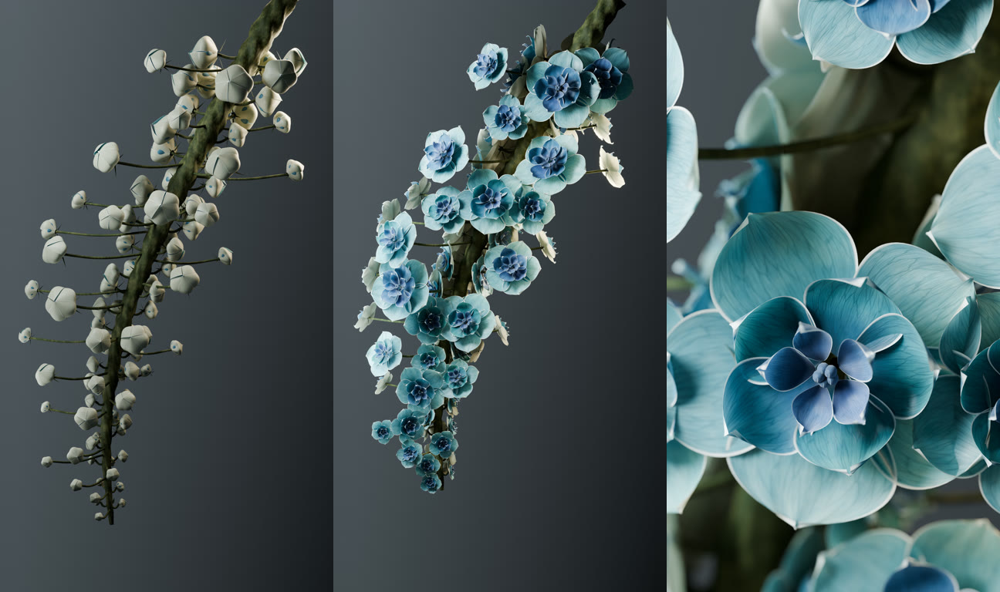
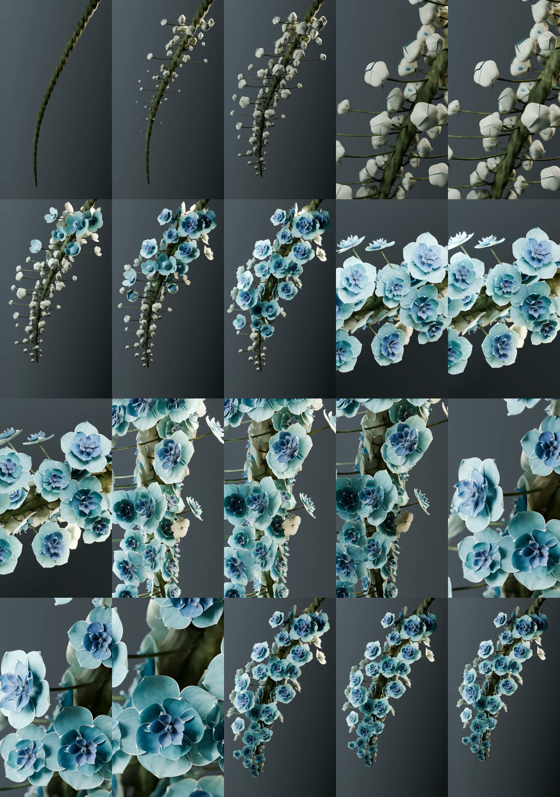

# 青蓝垂花 · 从冒芽到盛放

**16 秒 · 9:16 竖屏 · 原生 2160 × 3840 · 24 fps · 无声**

灰色背景前，一条弯曲的花枝逐渐长出乳白花苞。青蓝花瓣分层展开，细白边、灰紫色层和顺向纹理在侧光下显现。七个镜头穿插整枝、斜侧和微距转焦，远景占 8.5 秒。

[观看 / 下载 1080 预览](preview.mp4) · [下载 4K 成片](https://github.com/huangxin-design/blender-beginner/releases/download/works-blue-blossoms-2026-09-24/blue-hanging-blossoms-4k.mp4) · [下载可编辑工程](source/scene.blend) · [复现方法](source/README.md)

## 从一句反馈到镜头修改

> 花朵加一点白色描边，丰富的纹理颜色，还有焦距感 镜头感

> 花苞生长冒头的镜头也需要制作

> 远景多一点

以上为本作品制作会话中的用户原话摘录。前两项落实为连续的乳白薄边、青蓝与灰紫色素变化、径向细脉和真实景深；花梗与花苞分别生长，接着由上到下错拍开花。最后把远景从 V7 的 4 秒增加至 V8 的 8.5 秒，再按确认的剪辑渲染原生 4K。

[精简制作对话](conversation.md)按实际轮次整理；[示例提示词](prompts.md)是后续重写稿，二者分别标注。本案例属于独立作品展示，不代表一次生成，也不增加 Skill 的验证数量。

## 16 秒镜头安排

| 时间 | 镜头 |
| --- | --- |
| 0–3 秒 | 冒芽远景，花梗伸出、花苞鼓起 |
| 3–4 秒 | 花苞褶面近景 |
| 4–7 秒 | 整枝开花，观察由上到下的展开节奏 |
| 7–9 秒 | 左侧斜角，观察花瓣薄边与透光 |
| 9–11 秒 | 另一侧的下段花群 |
| 11–13.5 秒 | 俯角微距，由左上主花转焦到前方花朵 |
| 13.5–16 秒 | 盛放远景，轻轻拉远收尾 |

## 工程和画面

96 组花梗与花朵位置，通过几何节点实例化七套花型。花瓣使用原生形态键控制闭合、杯状停留和舒展，花梗伸长与花苞鼓起各有独立动画。相机、焦点、移动灯光和程序化材质均保存在 `.blend` 内。

成片来自 Blender 三维场景逐帧渲染，没有用图像生成后期替代几何、材质或景深。网页预览只是缩小和编码；4K 下载件保留最终交付视频的原始字节。

本次只归档实际 V8 最终交付。V1–V7 的阶段成果仍在作者本地，未在仓库补造版本目录。[版本与处理摘要](conversation.md)

## 渲染与检查

- Blender 5.2.1 LTS，Cycles / OptiX，RTX 4070 Ti / 12 GB；最高 128 采样，自适应阈值 0.015，最低 24 采样，降噪。
- 全部 384 帧为原生 2160 × 3840、16 位 RGB PNG；视频为 H.264。无音轨，不是无缝循环。
- 原交付记录覆盖完整序列、准确时长和全片解码。本次归档另做工程搬移重开、原生驱动检查、低分辨率试渲染及 1080 预览解码。
- Token 未独立统计。仅保留部分逐帧计时，不将其外推为整片渲染耗时。

发布副本更新了工程内过时的 V2 使用说明和输出路径，清空了文件浏览器目录；相机与生长动画在 17 个代表帧上与原交付对比一致，材质与动画数据未修改。未公开约 8.9 GB 的逐帧 PNG、临时日志或本地环境配置。

[花瓣细节](images/macro.jpg) · [验证范围](verification.json) · [文件与 SHA256](manifest.json) · [参考与署名](credits.md) · [全部作品](../README.md)
