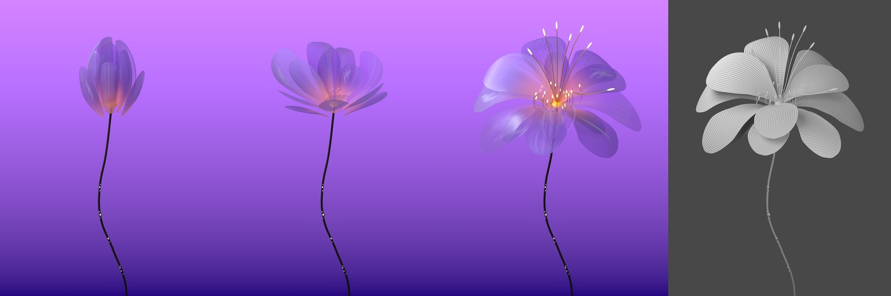

# 晶光绽放 · 半透明花瓣与同帧布线白模

紫粉色花瓣保持正常尺寸，从收拢状态直接展开。每片花瓣分别变形，保留柔软弧度和轻微波动；花蕊延后伸展，花枝上的小球发光。材质版与布线白模使用相同的花瓣几何、动画和相机。



从左到右：材质版第 1、73、180 帧，以及白模第 180 帧。每格保持 3:4；仅缩小拼图，未做生成式图像后期。

**[播放材质版 15 秒预览](versions/v009/preview.mp4) · [播放布线白模 15 秒预览](versions/v008/preview.mp4)**

[精简制作对话](conversation.md) · [复用提示词](prompts.md) · [素材与出处](credits.md) · [验证范围](verification.json)

发布后已重新下载完整工程包和两部 4K 视频，SHA-256 与压缩包校验通过；两份下载的工程均已在新目录用 Blender 5.2.1 打开，无缺失依赖。见[下载回查记录](qa/publication-download.json)。

## 视频和可编辑工程

| 实际版本 | 视频 | 工程与说明 |
| --- | --- | --- |
| V8 · 直接展开 / 布线白模 | [原生 4K 视频](https://github.com/huangxin-design/blender-beginner/releases/download/works-glass-bloom-2026-10-21/Glass_Bloom_Wireclay_4K_15s.mp4) · [轻量预览](versions/v008/preview.mp4) | [版本说明](versions/v008/README.md) · [下载完整工程包](https://github.com/huangxin-design/blender-beginner/releases/download/works-glass-bloom-2026-10-21/Glass_Bloom_4K_Project.zip) |
| V9 · 同表现 / 紫粉半透明材质 | [原生 4K 视频](https://github.com/huangxin-design/blender-beginner/releases/download/works-glass-bloom-2026-10-21/Glass_Bloom_Material_4K_15s.mp4) · [轻量预览](versions/v009/preview.mp4) | [版本说明](versions/v009/README.md) · [下载完整工程包](https://github.com/huangxin-design/blender-beginner/releases/download/works-glass-bloom-2026-10-21/Glass_Bloom_4K_Project.zip) |

两部主片均为 **原生 3072 × 4096、3:4、24 fps、360 帧、15 秒、无声**，未放大、补帧或变速。预览为 1152 × 1536。主片 H.264 High / Level 6.0；设备不支持时可看轻量预览。

工程包包含两份实际 `.blend`、17 套 SVG / 2K PNG 贴图、两部 4K 视频、预览及渲染脚本。大文件放在 Release，仓库的 Download ZIP 不包含它们。完整工程包解压后的 `glass-bloom/` 可直接使用；若单独复制工程，将白模保存为 `versions/v008/scene.blend`，材质版保存为 `versions/v009/scene.blend`，并保留各自旁边的 `textures/`。文件 SHA-256 见 [manifest.json](manifest.json)。

## 花瓣、纹理与动画

- 13 片独立花瓣，每片 56 × 24 个基础四边形、360 个原生绝对形态键。打开工程即可播放，无需重新模拟。
- 13 张各瓣独绘底纹，另有细脉、霜雾、晶粒、流线四类细节图。17 张 2048 × 2048 PNG 已打包进材质工程，SVG 可继续编辑。OUTER 01、OUTER 05、INNER 03 的膜区更通透。
- 花朵整体比例保持为 1，取消 V7 从小长大的阶段；花蕊随开花延后伸展。前约 7.5 秒展开，后半段保持盛开并轻微舒展。
- 白模使用灰色 UV 网格显示真实 56 × 24 控制四边形的边界，并非最终细分后所有边。花丝、花茎和小球是纯白材质。白模使用中性灯光；彩色版保留左上方柔光、暖色花心与 Bloom。

## 重新渲染

使用 Blender **5.2.1**。F12 渲染当前帧；Ctrl+F12 渲染动画。归档源工程与本次交付工程逐字节相同；不含从零重建早期各版的完整建模链。

`versions/v008/scripts/` 与 `versions/v009/scripts/` 保留实际生产渲染流程的发布适配版：只将源工程名改为 `scene.blend`、安装目录改为环境变量，并移除本机打包步骤；几何、材质与动作未修改。

本批处理适用于 Windows / NVIDIA OptiX，需要 Python、FFmpeg/ffprobe，Blender 自带的 NumPy、OpenImageIO 及 OIDN 库。将 Blender 加入 PATH，或设置 `BLENDER_BINARY` 为其可执行文件；`OIDN_LIBRARY_DIR` 默认取 Blender 旁的 `blender.shared`。

```powershell
# 在解压后的 glass-bloom 目录执行；先用工程内降噪渲染小样
blender --background versions/v009/scene.blend --python-exit-code 1 --python versions/v009/scripts/render_4k.py -- draft 180
# 完整材质版：64 采样、原生 4K、可断点续渲
python versions/v009/scripts/render_pipeline.py
# 完整白模版
python versions/v008/scripts/render_pipeline.py
```

生产流程为 Cycles GPU → 32 位多层 EXR → 带 Albedo / Normal 的 OIDN HIGH CPU 降噪 → Blender 原生色管与合成 → 16 位 PNG → H.264。OIDN 的 512 MB 目标不含图像缓冲及 Blender 本身。渲染和后处理顺序执行；结果写到各版本的 `renders/`、`previews/` 和以 `Glass_Bloom_` 开头的 MP4，保留归档的 `final.mp4` 与 `preview.mp4`。

已有两部影片的完整解码检查通过。花瓣碰撞结论来自 V8 的 360 个整数帧几何检查；V9 依据工程与姿态一致性继承结论，没有冒称重新检查连续运动。重新打开与发布检查见 [qa](qa/)。Token 与完整制作总耗时未独立统计。
