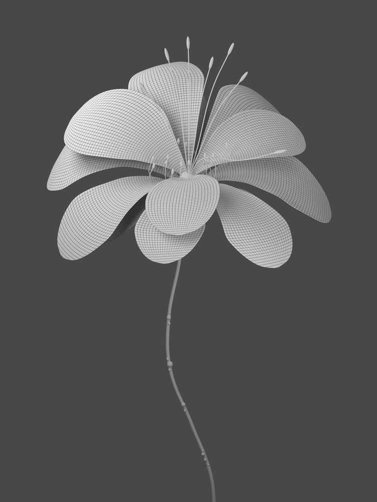

# V8 · 直接展开的布线白模

取消 V7 花朵整体从小长大的阶段，恢复正常尺寸直接展开；另制作带光影的布线白模。

[15 秒预览](preview.mp4) · [完整工程 ZIP](https://github.com/huangxin-design/blender-beginner/releases/download/works-glass-bloom-2026-10-21/Glass_Bloom_4K_Project.zip) · [返回案例](../../README.md) · [制作对话](../../conversation.md)

源工程位于完整下载包内的 `glass-bloom/versions/v008/scene.blend`，并非 Git LFS 指针。其 SHA-256 为 `095e30603022a73db3f070aa9a412ebcf170a21bcee6de285a678742f85a8419`。

制作环境：Blender 5.2.1 / Cycles / 64 samples；3072 × 4096 / 24 fps / 1–360 帧。预览是主片的缩小版。花瓣几何、花蕊节奏与镜头与另一版相同；灯光、色管和材质按白模 / 彩色用途分别设置。

修改花瓣可查看每个物体的绝对形态键；`FLOWER` 整体比例恒为 1，`STAMENS` 控制延后伸展。白模工程不依赖图像贴图，网格来自 UV 节点；`textures/` 保留同系独立纹理资料。17 张 PNG 内嵌于 V9 材质工程。

复现命令与实际渲染流程见[案例说明](../../README.md#重新渲染)。脚本是现有工程的重渲染入口，不是从零创建花朵的建模脚本。早期 V1–V7 未随本次案例归档，实际迭代关系保留于对话摘要。原生画面没有生成式图像后期；已做和未做的检查见[验证范围](../../verification.json)。
