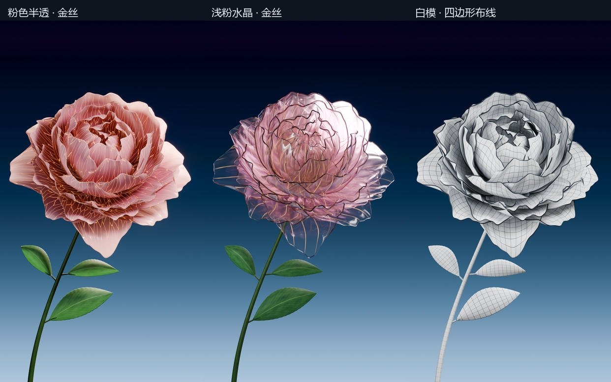

# 金丝花开 · 三种材质 4K

**三段独立视频 · 每段 10 秒 · 2160 × 3840 · 30 fps · 无声**

同一朵花，从合拢花苞展开为多层花瓣。花心保持固定，48 片外侧花瓣依次展开，三片叶子衬托花茎。三个版本分别呈现柔和的粉色半透明金丝、浅粉水晶金丝，以及可观察曲面走向的白模布线。

| 版本 | 成片 | 可编辑工程 |
| --- | --- | --- |
| 粉色半透金丝 | [下载 4K MP4](https://github.com/huangxin-design/blender-beginner/releases/download/works-gold-silk-flower-2026-09-24/01_Rose_Gold_4K_10s_2160x3840.mp4) | [下载 .blend](https://github.com/huangxin-design/blender-beginner/releases/download/works-gold-silk-flower-2026-09-24/01_Rose_Gold_4K.blend) |
| 浅粉水晶金丝 | [下载 4K MP4](https://github.com/huangxin-design/blender-beginner/releases/download/works-gold-silk-flower-2026-09-24/02_Rose_Crystal_4K_10s_2160x3840.mp4) | [下载 .blend](https://github.com/huangxin-design/blender-beginner/releases/download/works-gold-silk-flower-2026-09-24/02_Rose_Crystal_4K.blend) |
| 白模四边形布线 | [下载 4K MP4](https://github.com/huangxin-design/blender-beginner/releases/download/works-gold-silk-flower-2026-09-24/03_Clay_Wire_4K_10s_2160x3840.mp4) | [下载 .blend](https://github.com/huangxin-design/blender-beginner/releases/download/works-gold-silk-flower-2026-09-24/03_Clay_Wire_4K.blend) |

[完整工程包：三段视频、三份工程与 4K 静帧](https://github.com/huangxin-design/blender-beginner/releases/download/works-gold-silk-flower-2026-09-24/Gold_Silk_Flower_4K_Project.zip) · [版本与渲染方法](versions/v005-4k-trio/README.md) · [精简制作对话](conversation.md) · [可复用提示词](prompts.md)

## 从材质反馈到固定花心

最初需求是参考 Pinterest 的开花效果，随后增加叶片、半透明花瓣、独特纹理和发光金丝。第一次材质迭代仍有较强的褶皱与蜡感；用户继续指出渲染质感不自然，并明确要求“开花的时候 花朵中心应该是不动的”。

调整后，整朵花的平移、旋转与缩放被固定，花心最内侧的三片花瓣也保持静止。外层花瓣继续通过原生形态键展开。水晶版降低表面粗糙度、关闭蜡感较强的次表面散射，加入浅粉色吸收与稀疏金丝；粉色版则保留半透明花瓣及较密的金色纹理。

用户最终要求把这两种材质加上白模布线，分别输出 4K 视频。这里归档实际的 **v5 / 三材质 4K 最终版**，没有把多次返工写成一次生成，也没有将参考图的“1:1”要求写成已达到的还原精度。中间 v1–v4 未随本案例公开。

## 三版共用什么

- 相同构图、固定机位与开花形态键动画；51 片花瓣，其中 48 片展开、3 片花心固定。
- 三片真实几何叶片与固定花茎；材质均在工程内，没有外部贴图依赖。
- 第 1–217 帧为原生渲染序列，第 217–300 帧处于同一个静止盛开状态。编码时准确延续 83 帧，组成 300 帧 / 10 秒视频。
- 直接以 2160 × 3840 渲染；没有把小尺寸视频放大，也没有运动插帧。

白模的花瓣与叶片按原始 U/V 四边形网格方向抽稀显示布线，帮助观察曲面与形态键变化；它不是所有细分边的逐条展示。花茎和叶柄使用真实几何 Wireframe 修改器。

[粉色版阶段图](rose-stages.jpg) · [水晶版阶段图](crystal-stages.jpg) · [白模阶段图](clay_wire-stages.jpg)

## 环境、耗时与验证范围

Blender **5.2.1 LTS**，Cycles / OptiX，64 samples；制作设备为 **RTX 4070 Ti / 12 GB**。三个视频均为 H.264、YUV420P、30 fps、300 帧，无音轨。

| 版本 | 已记录渲染段累计 |
| --- | --- |
| 白模布线 | 约 3 小时 10 分 |
| 粉色半透金丝 | 约 3 小时 47 分 |
| 浅粉水晶金丝 | 约 6 小时 53 分 |

计时来自实际帧循环记录，包含帧切换、渲染与 PNG 保存，以及复用的 4K 盛开样帧；粉色版合并了中断前后的两段记录。不包含建模、材质迭代、排队停机、视频编码或本次归档。制作期间有其他显卡任务，数据不能作为独占 GPU 的性能基准。**Token 未独立统计。**

生产验证覆盖三版各 300 帧的固定花心检查，中心画面坐标漂移为 0。归档时从新位置重新打开三份 `.blend`，检查尺寸、时间轴、花瓣数量、固定中心与外部依赖。

2026-09-24 对三段视频的全部 **900 帧原生 2160 × 3840 YUV420P 画面**进行 FFmpeg `h264` 软件解码与 NVIDIA `h264_cuvid` 硬件解码对比，逐帧哈希全部一致；另实际查看了解码后的开头、中段和末帧。播放器界面检查被用户停止，未完成三段影片的完整人工播放验收；未验证所有播放器、设备或操作系统。[验证记录](verification.json) · [解码代表帧](qa/decoded-contact-sheet.jpg)

这是作者的独立制作案例，属于 GitHub 展示资料，不增加 Skill 的功能或一次生成验证数量。

[参考出处](credits.md) · [下载文件与 SHA256](manifest.json) · [全部作品](../README.md)
