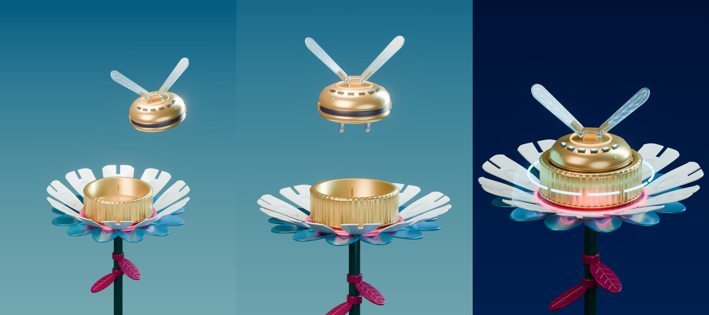

# 机械花 · 发光玻璃翼

一个参考短片展开的 Blender 机械动画案例：金属机械花、磨砂玻璃翅膀、发光翼纹，以及围绕飞行、停靠、充能和离场编排的科幻音效。

[播放轻量预览](preview.mp4) · [精简对话](conversation.md) · [本次归档说明](brief.md) · [可复用提示词](prompts.md) · [素材与制作边界](credits.md) · [制作经验](lessons.md)

## 成片与工程

成片为原生 **3072 × 4096、竖版 3:4、24 fps、393 帧，画面时长 16.375 秒**。模型、材质、灯光和动画均在 Blender 中制作并渲染；翼面发光纹理使用生成式图像素材作为贴图，成片未做 AI 图像后期。

| 文件 | 下载与用途 |
| --- | --- |
| 4K WebM | [mechanical-flower-4k.webm](https://github.com/huangxin-design/blender-beginner/releases/download/works-mechanical-flower-2026-10-14/mechanical-flower-4k.webm)，VP9 + Opus |
| 4K MP4 | [mechanical-flower-4k-hevc.mp4](https://github.com/huangxin-design/blender-beginner/releases/download/works-mechanical-flower-2026-10-14/mechanical-flower-4k-hevc.mp4)，HEVC Main10 + AAC，需要播放器支持 HEVC |
| 可编辑工程 | [mechanical-flower-project.zip](https://github.com/huangxin-design/blender-beginner/releases/download/works-mechanical-flower-2026-10-14/mechanical-flower-project.zip)，包含实际 `.blend`、贴图、声音和脚本 |
| 文件校验 | [SHA256SUMS.txt](https://github.com/huangxin-design/blender-beginner/releases/download/works-mechanical-flower-2026-10-14/SHA256SUMS.txt) |

仓库中的 `preview.mp4` 是浏览用预览，原生 4K 成片与约 80 MB 的源场景放在上述 Release。工程包解压后从 `source/scene.blend` 打开；仓库的 [source/README.md](source/README.md) 说明重新渲染、编码与生成混音的方法。脚本以保存的场景为输入，**不包含从零建模的完整重建链**。

## 三个片段

| 飞行 | 停靠 | 充能 |
| --- | --- | --- |
|  |  |  |

## 这次实际归档了什么

本次是已有项目的整理发布，保留实际来源版本关系，没有事后补造一套历史工程。

| 制作阶段 | 与本次发布的关系 | 公开归档状态 |
| --- | --- | --- |
| 早期白膜、v2 动作优化、v3 材质版 | 用于确定机械动作、画幅和材质方向 | 中间版本未公开归档 |
| v4 玻璃与金属材质场景 | 发布工程的场景基础，含磨砂玻璃、发光翼纹与机械细节 | 实际场景的发布副本在工程包中 |
| v5 原生 4K 渲染 | 提供 393 张原始 Blender 渲染帧 | 完整帧序列未上传，可由源场景重新渲染 |
| v6 播放修复与科幻混音 | 从 v5 原帧重新编码，加入本地制作的科幻音效 | 本次公开的最终成片与配套资源 |

## 验证与限制

旧 H.264 文件在本机 D3D11VA 硬件解码时出现蓝色块状残影，原始渲染帧与软件解码正常。新 VP9、HEVC 文件各完成全片软件／严格硬件解码对照，同一像素格式下 **393/393 帧像素哈希一致**。这是本机解码路径的验证，不代表所有浏览器、显卡和播放器都已测试；旧编码的具体触发特征尚未单独隔离。

发布检查见 [verification.json](verification.json)，文件清单见 [manifest.json](manifest.json)，历史解码对照见 [qa/full-decode-comparison.json](qa/full-decode-comparison.json)。WebM 容器可能显示 16.383 秒，这是 Opus 包尾所致；实际画面及解码后音频均为 16.375 秒。

声音为本地制作的玻璃气流、磁性驱动、花瓣伺服、充能与起飞混音。ElevenLabs 仅做过资料研究和提示词准备，**没有用于本片音效生成**。参考出处及尚未核实的许可边界见 [credits.md](credits.md)。
