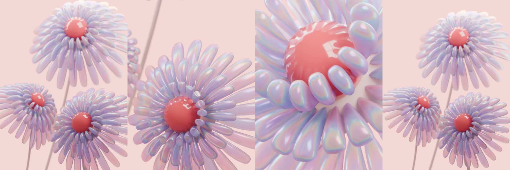
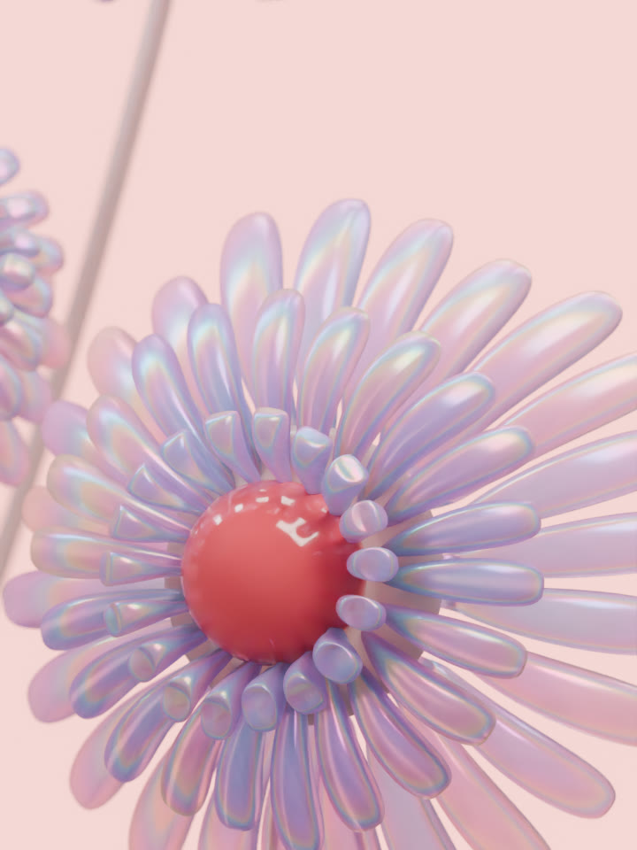
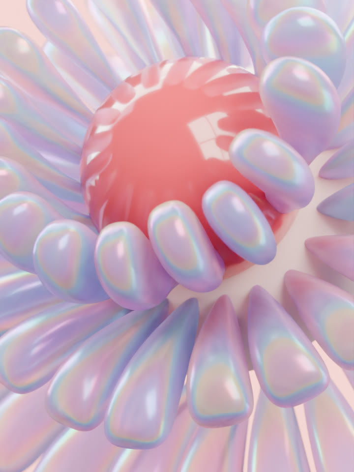

# 虹彩磨砂玻璃花 · 前景与景深

三朵大小错落的玻璃花，在粉色背景中缓慢开合。花瓣带乳白半透底色与青、紫、粉、淡金色的边缘反光；右下花位于前景，另外两朵花保留柔焦。

从左到右：开场全景 → 前景花近景 → 虹彩花瓣特写 → 收尾全景。选取成片第 1、97、217、360 帧，保留每格 3:4 比例，横向拼接展示。

[播放完整 15 秒视频](final.mp4) · [下载 Blender 工程](versions/v009/scene.blend) · [精简制作对话](conversation.md) · [可复用提示词](prompts.md) · [素材与出处](credits.md)

## 成片与源文件

| 项目 | 实际规格 |
| --- | --- |
| 成片 | 原生 Blender 渲染，720 × 960，3:4，24 fps，360 帧，15 秒，无声 |
| 工程 | Blender 5.2.1 LTS，Cycles；1080 × 1440、64 samples 的可编辑母版设置 |
| 本次视频渲染 | 720 × 960、32 samples；没有把预览放大为高分辨率成片 |
| 贴图 | 四张 2K 贴图内嵌在工程中 |
| 镜头 | 全景、右下花近景、花瓣特写、全景收尾；切点为第 1、73、181、289 帧 |
| 图像后期 | 没有 AI 图像精修；横向预览由四张原生渲染帧等比缩小、拼接为 1920 × 640 JPEG |

工程保留花瓣形态键、花头与花茎动画、虹彩材质、灯光和相机景深。下载 `.blend` 时，在 GitHub 文件页选择 **Download raw file**，即可直接打开继续编辑。

| 实际版本 | 归档内容 | 文件 |
| --- | --- | --- |
| v001–v008 | 白模、材质、构图、景深与间距调整的前序制作阶段；本次未公开这些中间工程 | [制作过程摘要](conversation.md) |
| v009 | 右下花移到最前方，全部动作与四个镜头统一为 15 秒 | [工程](versions/v009/scene.blend) · [版本说明](versions/v009/brief.md) · [渲染与检查入口](versions/v009/README.md) |

本次只归档真实的 v009 完成版，不将它重新编号为首版。脚本用于从保存的工程重新渲染、编码和检查，不包含从零建模的完整重建链。

## 画面与检查

| 前景花近景 | 花瓣特写 |
| --- | --- |
|  |  |

- 全部 360 帧跨花表面检查：不同花朵、花头与其他花茎之间没有三角相交。
- 全部 360 帧 × 3 朵花：花瓣彼此的检查包含尖根，交叉为 0；花心与花托保留根部连接。
- 完整视频已验证 360 帧、24 fps、15 秒、3:4，并完成严格软件解码。
- 发布时另检查迁移后的工程、内嵌贴图和实际预览，见 [verification.json](verification.json)。

碰撞检查针对每个整数帧的实际细分表面，不是连续子帧的物理碰撞仿真。花心与花托接合区域单独记录；详细结果在 [qa](qa/)。

Token 与完整制作耗时未独立统计。这个案例来自多轮实际修改，不代表 Skill 一次生成的效果。文件大小与校验值见 [manifest.json](manifest.json)，制作中遇到的问题见 [lessons.md](lessons.md)。
