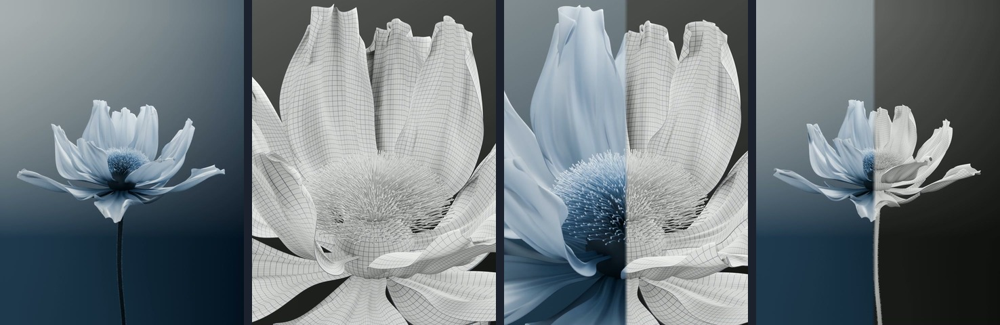

# 银蓝花开 · 波浪花瓣与布线白模

银蓝色花瓣从花苞逐渐展开，宽幅波浪沿瓣面传播，瓣缘保留轻微飘动。半透明材质、纵向纹理、缩小的花蕊与花枝细毛一起形成柔软的层次；同帧白模与材质合剪展示模型和成片的对应关系。



从左到右：彩色第 450 帧 → 白模第 260 帧 → 合剪第 273 帧 → 合剪第 353 帧。每格保持 3:4 比例。

**[播放 15 秒合剪](versions/v006/final.mp4) · [播放彩色修正版](versions/v004/final.mp4) · [播放白模轻量预览](versions/v005/preview.mp4)**

[精简制作对话](conversation.md) · [复用提示词](prompts.md) · [素材与出处](credits.md)

## 视频与工程

| 实际版本 | 视频 | 可编辑工程与说明 |
| --- | --- | --- |
| V4 · 银蓝材质黑帧修正版 | [720 × 960 原生渲染](versions/v004/final.mp4) | [下载 Blender 工程](https://github.com/huangxin-design/blender-beginner/releases/download/works-silver-bloom-2026-10-19/Silver_Bloom_V4_3x4_Fixed.blend) · [版本说明](versions/v004/README.md) |
| V5 · 带光影的布线白模 | [原生 2880 × 3840 / 4K](https://github.com/huangxin-design/blender-beginner/releases/download/works-silver-bloom-2026-10-19/Silver_Bloom_Clay_Wire_4K_15s.mp4) · [720 × 960 预览](versions/v005/preview.mp4) | [下载 Blender 工程](https://github.com/huangxin-design/blender-beginner/releases/download/works-silver-bloom-2026-10-19/Silver_Bloom_Clay_Wire_4K.blend) · [版本说明](versions/v005/README.md) |
| V6 · 材质与白模合剪 | [1080 × 1440 预览](versions/v006/final.mp4) | [剪辑说明](versions/v006/README.md) · [合成脚本](scripts/edit_comparison.py) |

三版均为 **15 秒、30 fps、450 帧、3:4 竖版、无声**。彩色视频原生分辨率为 720 × 960；白模原片为原生 2880 × 3840；合剪将彩色原片放大、白模原片缩小到 1080 × 1440，因此合剪不是原生 4K。视频为 H.264 / yuv420p。

工程由 **Blender 5.2.1 LTS** 制作。V4 使用 Cycles，视频为 128 采样；保存工程的默认设置为 1080 × 1440、256 采样。V5 使用 EEVEE、64 采样。两份 `.blend` 内均已打包 4 张 2K 贴图，无需另找贴图或毛发缓存；工程打开后停在第 330 帧。选择 `FLOWER · Bloom 主控制`，可调整 `Bloom`、`Wave Amount` 和 `Flutter Amount`。

大文件存放于 Release，不包含在仓库 ZIP 中。下载后按下面的路径保存，供脚本读取；文件大小与 SHA256 见 [manifest.json](manifest.json)。

| Release 文件名 | 下载后保存位置 |
| --- | --- |
| `Silver_Bloom_V4_3x4_Fixed.blend` | `versions/v004/scene.blend` |
| `Silver_Bloom_Clay_Wire_4K.blend` | `versions/v005/scene.blend` |
| `Silver_Bloom_Clay_Wire_4K_15s.mp4` | `versions/v005/final.mp4` |

## 修改与检查

- **波浪与材质。** 花瓣交错展开，保留纵向褶皱、半透明感和瓣缘轻颤；花枝增加细毛，并用侧光和轮廓光加强花瓣层次。
- **黑帧修复。** 原 V4 部分花瓣异常变黑，修正版补渲受影响的 89 帧，关闭持久渲染缓存，并取消片尾曝光淡出。旧问题视频未作为本案例成片发布。
- **白模展示。** V5 保持几何、形态键、动画和镜头构图，调整白模材质及灯光，关闭景深和辉光。网格材质按原始 UV 显示花瓣 40 × 56 四边形布线，不是逐条显示最终细分后的所有边；细小花丝与绒毛使用白色材质。
- **同帧合剪。** V6 不变速，不打乱开花顺序；每次切入新镜头先展示白模，再从左向右擦入彩色，最后 12.25–15 秒保留彩色成品。

已有检查覆盖两版源图完整性、三份成片的帧数与时长、完整解码及黑场检测；白模工程另做几何与动画一致性比较、15 个时刻的驱动检查。合剪抽查镜头切点与三次擦换的姿态对齐。检查范围与依据见 [verification.json](verification.json) 和 [qa](qa/)；这些记录不代表全时段连续碰撞检测。

## 重新渲染与剪辑

先下载上述文件，在本案例目录执行。需要 Blender 5.2.1、Python 3、`ffmpeg` 和 `ffprobe`；以下命令假设它们已加入 PATH。

```sh
# 先查看彩色第 330 帧的小样
blender --background --python-exit-code 1 --python scripts/render.py -- --version v004 --start 330 --end 330 --scale 0.5 --samples 32

# 完整彩色序列：每 10 帧启动新进程，默认使用 CPU
python scripts/render_batches.py --version v004
python scripts/encode.py --version v004

# 完整 4K 白模序列：每 30 帧启动新进程，EEVEE 使用图形设备
python scripts/render_batches.py --version v005
python scripts/encode.py --version v005

# 从归档 V4 工程另存白模派生工程
blender --background --python-exit-code 1 --python scripts/build_wire_clay.py

# 以归档的两份成片重新合剪
python scripts/edit_comparison.py
```

彩色渲染可追加 `--device OPTIX` 使用支持 OptiX 的 NVIDIA 显卡；这个参数不控制 EEVEE。`--blender` 可向分批脚本指定 Blender 可执行文件路径。`--scale` 是分辨率倍率，例如 `0.25` 表示宽高各为四分之一。

新序列和编码写入 `output/v004/`、`output/v005/`；白模派生工程为 `output/wire-clay-rebuilt.blend`；合剪为 `output/v006/final.mp4`。这些入口不覆盖归档文件。合剪脚本固定读取 `versions/` 中的两份成片。脚本覆盖已有工程的重渲染、白模派生和合剪，不包含早期版本的完整从零建模链。未使用生成式图像后期替代 Blender 画面；未单独统计完整制作总耗时与 Token。
