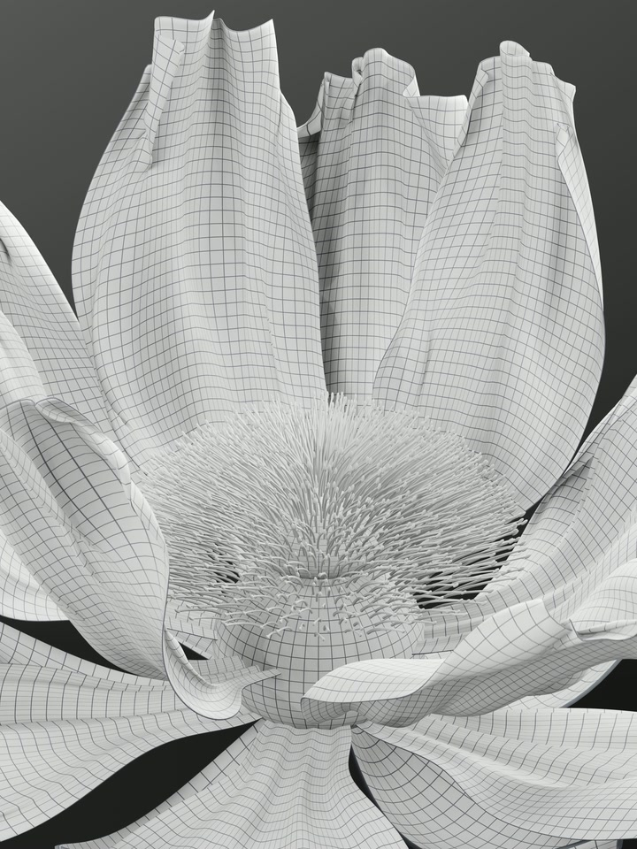

# V5 · 带光影的 4K 布线白模



**[播放轻量预览](preview.mp4) · [下载原生 4K 视频](https://github.com/huangxin-design/blender-beginner/releases/download/works-silver-bloom-2026-10-19/Silver_Bloom_Clay_Wire_4K_15s.mp4) · [下载 Blender 工程](https://github.com/huangxin-design/blender-beginner/releases/download/works-silver-bloom-2026-10-19/Silver_Bloom_Clay_Wire_4K.blend)**

任务：由 [V4 修正版](../v004/README.md) 制作带灯光的布线白模。保持花朵几何、形态键、动画与镜头构图，使用哑光白材质、中灰网格和中性摄影棚灯光，关闭景深和辉光，便于观察花瓣层次。

花瓣线条按原始 UV 显示 **40 × 56 四边形网格**，随形态键及细分变形；花萼、花茎和花托也显示对应网格。它不是逐条显示最终细分后的所有边。细小花丝和花枝绒毛使用白材质，避免过密线条盖住造型。

| 项目 | 实际设置 |
| --- | --- |
| 原片 | 原生 2880 × 3840，长边 3840 像素，3:4 |
| 仓库预览 | 720 × 960，由 4K 原片缩小 |
| 动画 | 30 fps，450 帧，15 秒，无声 |
| 渲染 | Blender 5.2.1 LTS / EEVEE，64 采样 |
| 编码 | H.264，CRF 16，yuv420p |

Release 的 `Silver_Bloom_Clay_Wire_4K.blend` 下载后保存为本目录 `scene.blend`；`Silver_Bloom_Clay_Wire_4K_15s.mp4` 保存为本目录 `final.mp4`。大小与 SHA256 见 [manifest.json](../../manifest.json)。两者不包含在仓库 ZIP 中。保存工程停在第 330 帧，保留原有开花和波浪控制，贴图已打包，无外部毛发缓存依赖。

在案例根目录重渲染归档工程：

```sh
python scripts/render_batches.py --version v005
python scripts/encode.py --version v005
```

每 30 帧重启 Blender，输出到 `output/v005/`，EEVEE 使用图形设备。若只需从 V4 再派生一份白模工程，可执行：

```sh
blender --background --python-exit-code 1 --python scripts/build_wire_clay.py
```

派生结果为 `output/wire-clay-rebuilt.blend`，不会覆盖归档工程；原有 V4 工程须先下载到指定位置。

原生一致性审计确认网格、形态键、动画和相机保留，15 个抽查时刻的驱动有效。4K 源图完整性、450 帧视频完整解码、时长和无黑场检查通过；不是全时段连续碰撞检测。依据见 [verification.json](../../verification.json)、[qa](../../qa/)；参考与材质来源见 [credits.md](../../credits.md)。
