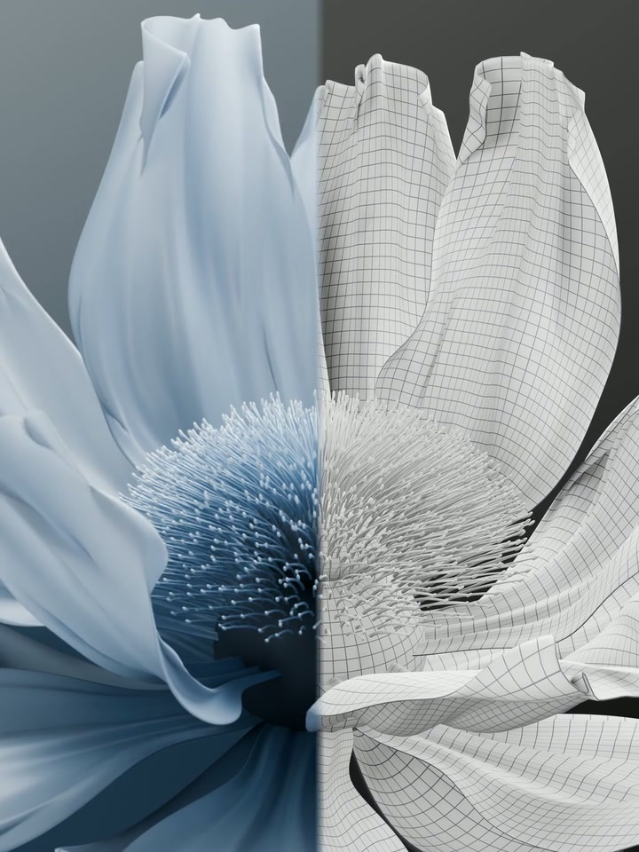

# V6 · 材质与布线白模合剪预览



**[播放 15 秒合剪](final.mp4)**

任务：将 [V4 彩色修正版](../v004/README.md) 与 [V5 白模](../v005/README.md) 剪在一起，展示相同模型和动画的两种外观。两版使用相同时间和动画帧，不变速、不打乱开花顺序。

输出为 **1080 × 1440、3:4、30 fps、450 帧、15 秒、无声**。彩色原片为 720 × 960，合成时放大；白模原片为原生 2880 × 3840，合成时缩小。该文件是合剪预览，不是原生 4K 成片，也没有单独的 Blender 剪辑工程。

| 时间 | 内容 |
| --- | --- |
| 0–2.93 秒 | 彩色花苞片头 |
| 2.93–5.30 秒 | 花苞展开白模，随后擦入彩色 |
| 5.30–7.57 秒 | 彩色花瓣展开 |
| 7.57–9.40 秒 | 花蕊与花瓣白模细节，随后擦入彩色 |
| 9.40–9.93 秒 | 彩色细节 |
| 9.93–12.25 秒 | 盛开白模全景，随后擦入彩色 |
| 12.25–15 秒 | 彩色全貌与花瓣波浪 |

表中时间作两位小数显示。使用 [合成脚本](../../scripts/edit_comparison.py) 可重建精确帧边界和从左至右的擦换。先把 V5 的 4K Release 视频下载为 `versions/v005/final.mp4`，再于案例根目录执行：

```sh
python scripts/edit_comparison.py
```

需要 Python 3、`ffmpeg` 和 `ffprobe`。脚本读取 `versions/v004/final.mp4` 与 `versions/v005/final.mp4`，输出 `output/v006/final.mp4`、剪辑时间表、滤镜表达式及验证记录，不覆盖归档成片。

完整解码、450 帧 / 30 fps / 15 秒与无黑场检查通过。抽查第 89、228、299 帧镜头切点及第 148、273、353 帧擦换中段，姿态与源视频对应，未见采样切点彩色闪回；第 450 帧保持彩色可见。以上为明确帧抽查，不是新一轮逐帧视觉审查。详见 [verification.json](../../verification.json) 与 [qa](../../qa/)，文件校验值见 [manifest.json](../../manifest.json)。
