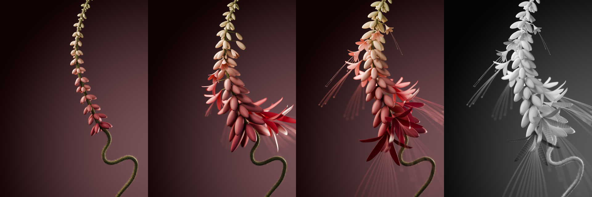

# 螺旋花序 · 旋转生长与布线白模

花朵沿螺旋次序一边旋转、一边长大，花瓣与细丝从上到下逐渐加长、加密。彩色成片和带光影的布线白模使用相同的位置、动画、镜头与景深，可以逐帧对照。



从左到右：彩色第 181 帧 → 第 535 帧 → 第 900 帧 → 白模第 900 帧。每格保持 3:4 比例。

**[播放彩色成片](versions/v013/final.mp4) · [播放布线白模](versions/v014/final.mp4)**

[精简制作对话](conversation.md) · [复用提示词](prompts.md) · [素材与出处](credits.md)

## 视频与可编辑工程

| 实际版本 | 高清成片 | 轻量预览 | Blender 工程 |
| --- | --- | --- | --- |
| V13 · 连续旋转彩色版 | [1080 × 1440](versions/v013/final.mp4) | [720 × 960](versions/v013/preview.mp4) | [scene.blend](versions/v013/scene.blend) · [版本说明](versions/v013/README.md) |
| V14 · 同动画布线白模 | [1080 × 1440](versions/v014/final.mp4) | [720 × 960](versions/v014/preview.mp4) | [scene.blend](versions/v014/scene.blend) · [版本说明](versions/v014/README.md) |

两版均为 **15 秒、60 fps、900 帧、3:4 竖版、无声**。工程由 Blender 5.2.1 LTS / Cycles 制作；成片为原生 1080 × 1440 渲染，128 自适应采样上限，保留微距景深、运动模糊、光晕和茎杆细毛。视频使用 H.264 / YUV420 / Rec.709 / faststart，未通过插帧生成动作。

两份 `.blend` 是真实完整工程；在 GitHub 文件页选择 **Download raw file**，或下载仓库后直接打开。只有 V13、V14 完成版在本案例归档；早期修改没有重新编号或伪装成首次生成。

## 这轮主要改了什么

- **连续的旋转节奏。** 前版每段独立缓入缓出造成反复急停。V13 改成连续正速度曲线积分，三次加速之间保持转动；峰值约 61°/秒，60 fps 下最大单帧转角约 1°。
- **相同动画的白模。** V14 仅改材质与灯光色相，128 朵花使用原始 10 列 × 22 行花瓣四边形 UV 布线，随形态键与细分一起变形；茎杆、细丝与毛发使用白模材质。
- **真实的检查边界。** 两版 900 帧源图完整性、编码帧数、时长、时间戳与完整解码通过；主动作段 2–12 秒没有相邻重复图像。第 858–900 帧沿用原动画的静止停留。

V13 的表面相交检查覆盖八个重点时刻，排除花瓣连接根部及主茎绒毛；没有发现所检查的花瓣互穿、自交或细丝新增交叉。这不是所有子帧的连续碰撞证明。V14 的几何、动画、相机、景深及尺寸一致性检查通过。完整依据见 [检查汇总](verification.json) 与 [qa](qa/)。

## 重新渲染

在本案例目录执行（`blender`、Python 3 和 `ffmpeg` / `ffprobe` 需可用）：

```sh
blender -b versions/v014/scene.blend --python-exit-code 1 --python scripts/render.py -- --start 900 --end 900
blender -b versions/v014/scene.blend --python-exit-code 1 --python scripts/render.py -- --start 1 --end 900 --device OPTIX
python scripts/encode.py --version v014
```

默认使用 CPU；`--device OPTIX` 适用于支持 OptiX 的 NVIDIA 显卡。彩色版把 `v014` 换成 `v013`。输出写入被 Git 忽略的 `output/v013/` 或 `output/v014/`，不会覆盖已归档成片。`--scale 50 --samples 32` 可先出小样；编码入口要求完整的 1080 × 1440 序列。

[白模转换脚本](scripts/build_wire_clay.py) 从已归档 V13 工程生成新的白模工程，保存为 `output/wire-clay-rebuilt.blend`，并检查几何与动画是否保持一致。运行：

```sh
blender -b --python-exit-code 1 --python scripts/build_wire_clay.py
```

这些入口覆盖从现有工程重新渲染、编码及 V13→V14 材质转换；不包含 V1→V13 的完整从零重建链。Token 与完整制作总耗时没有独立统计。没有使用生成式图像后期替代 Blender 渲染。文件校验值见 [manifest.json](manifest.json)。
