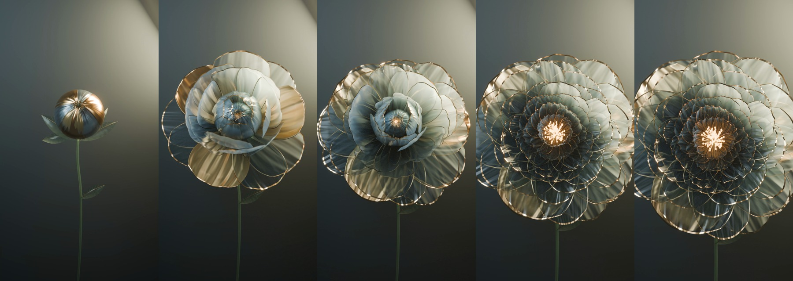
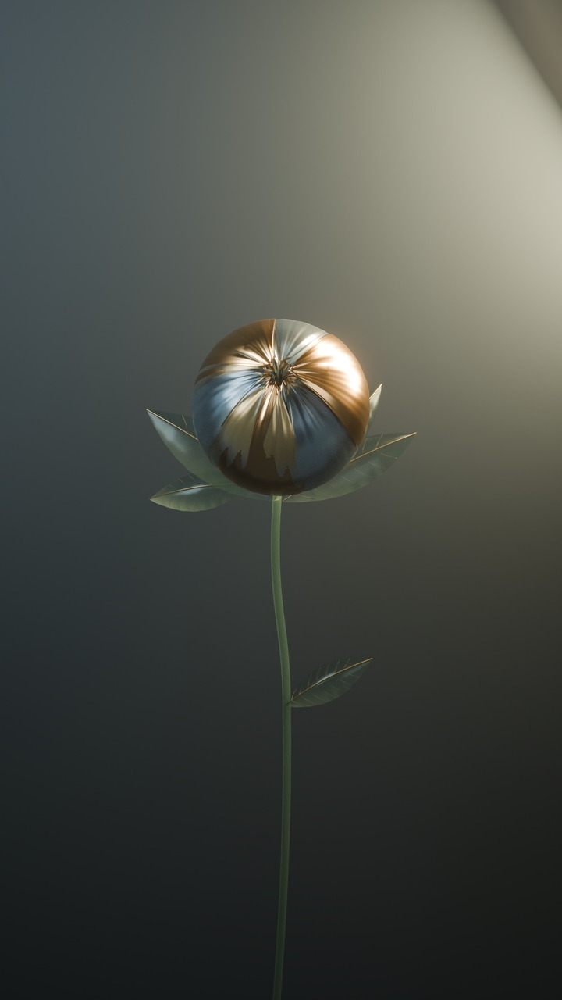
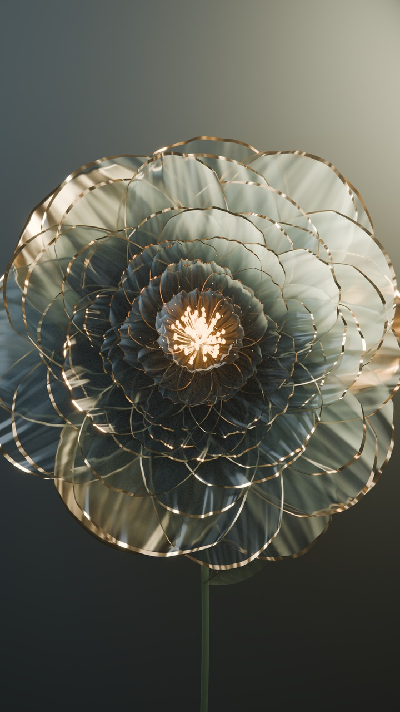
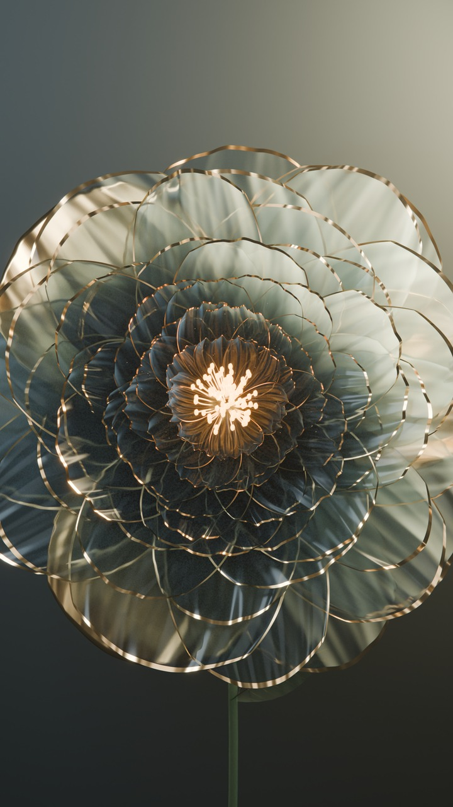

# 姚黄初绽 · 玻璃与金属的牡丹

**10 秒 · 9:16 竖版 · 原生 2160 × 3840 · 24 fps · 240 帧 · 无声**

一枚磨砂玻璃与香槟金属交织的花苞，在柔光中逐层展开。内层花蕊透出暖金色的光，细小花粉漂浮；镜头由远到近推进，从半透明的枝叶走近盛放的牡丹。

[观看 / 下载 1080 预览](preview.mp4) · [下载 4K 成片](https://github.com/huangxin-design/blender-beginner/releases/download/works-yaohuang-peony-2026-09-24/yaohuang-peony-4k.mp4) · [可编辑 Blender 工程](source/scene.blend) · [完整交付包与 4K 静帧](https://github.com/huangxin-design/blender-beginner/releases/download/works-yaohuang-peony-2026-09-24/yaohuang-peony-v007-project.zip)

## 从一个花苞开始

这次最关键的反馈是：“完全不一样 你看参考作品 是一个花苞生长的全部效果”。作品随后围绕单朵牡丹从闭合到盛放的连续过程展开，再逐步确认玻璃与金属、发光花蕊、朦胧镜头、半透明枝叶，以及有快有慢的开花节奏。

花朵先缓慢松苞，外瓣较快展开；中段稍作停顿，内瓣再加速打开，最后缓缓停在盛放状态。花瓣使用玻璃、透光与透明材质混合，配合金属细边；叶片、枝干也保留透光质感。景深、薄雾、辉光和轻微镜头效果都保存在工程中。

| 开场 · 枝叶与花苞 | 花心显露 | 盛放 · 镜头推近 |
| --- | --- | --- |
|  |  |  |

## 归档版本与继续编辑

| 实际版本 | 本次公开内容 | 入口 |
| --- | --- | --- |
| v007 · 原生 4K 最终版 | 沿用已确认的 v006 快慢节奏、材质与运镜，输出原生 4K | [工程与渲染方法](source/README.md) · [版本说明](brief.md) |

此前的造型、材质、镜头与节奏探索只在[精简对话](conversation.md)中回顾，中间工程未随本次归档发布。版本编号沿用实际制作记录。最终 `.blend` 是可编辑场景来源；随附脚本负责重新渲染，不声称从空场景重建全部造型。

Blender **5.2.1 LTS / Cycles**，最多 **128 samples**、自适应采样与降噪。工程包含形态键、原生动画曲线、灯光和合成节点，没有外部贴图或链接库；可以直接修改花瓣材质、花蕊亮度、相机景深和开花动作。完整包包括工程、渲染脚本、4K MP4、三张原生 4K PNG 及本案例说明；完整 240 张 PNG 序列未打包。

**Token 与完整制作耗时：本次未整理独立统计。** 不将其他作品或同机任务的记录归入本作品。

## 实际检查范围

原交付已校验 240 张原生 4K 帧、最终视频的完整解码、帧数和时长，并查看成片抽帧与细节。本次归档在新位置关闭自动执行后重开工程，检查尺寸、时间轴、依赖和五个时间点的相机动画；另从原成片生成 1080 预览与网页缩略图。原 4K 成片及 `.blend` 保持字节一致，没有重新渲染或生成式图像精修。

校验记录区分原交付检查与本次归档检查，未宣称在所有播放器或其他操作系统验证通过。[检查记录](verification.json) · [文件 SHA256](manifest.json)

[精简制作对话](conversation.md) · [可复用提示词](prompts.md) · [参考与署名](credits.md) · [全部作品](../README.md)
